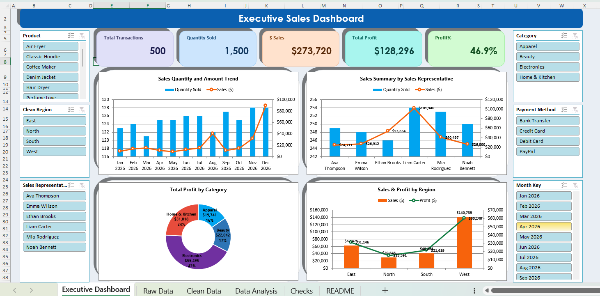
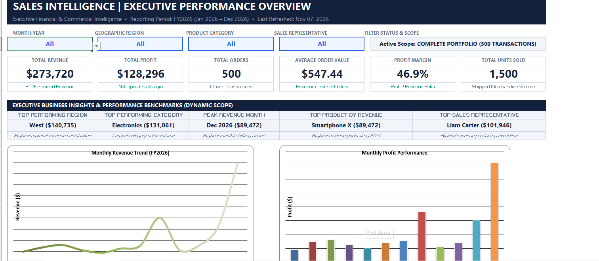
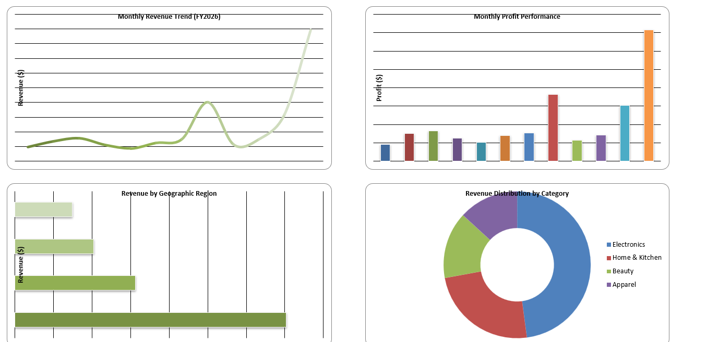
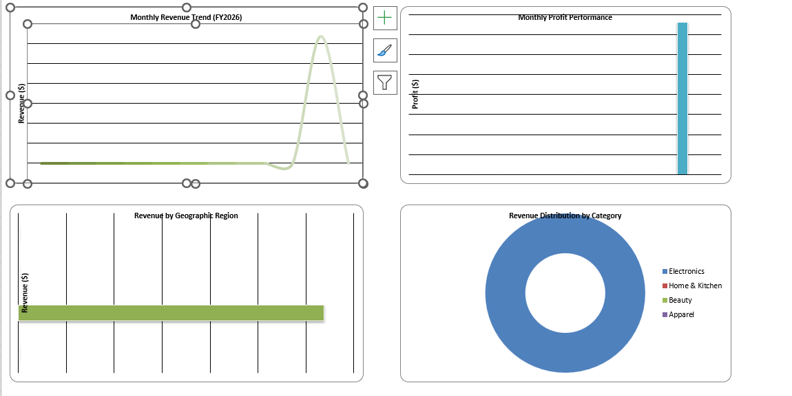

# Premium Sales Intelligence Dashboard – Excel
### Executive Business Intelligence & Commercial Operations Model

[](https://office.com)
[-107C41?logo=microsoft&logoColor=white)](https://powerbi.microsoft.com/power-query/)
[](https://github.com/Moazawad2002)
[](#-quality-assurance--integrity-audit)

---

## 📸 Executive Visual Showcase

<p align="center">
  
  <em>Figure 1: Full interactive Executive Sales Dashboard featuring synchronized multi-criteria slicers, KPI ribbons, regional performance analysis, and sales rep leaderboards.</em>
</p>

---

## 📊 Overview & Business Context

The **Premium Sales Intelligence Dashboard** is an enterprise-grade financial and commercial analytics model built entirely in **Microsoft Excel 365**. Developed from an accounting and information systems perspective, it demonstrates how structured data modeling, automated ETL (Power Query), and clean data visualization can replace fragile, manually maintained spreadsheets.

The dashboard consolidates transactional sales records (500 sanitized B2B orders totaling **$273,720** in revenue and **$128,296** in gross profit) to give leadership instantaneous visibility into operational margins, rep quotas, and regional revenue velocity.

---

## ⚠️ The Commercial Problem It Solves

- **Reporting Latency:** Executive leadership previously waited days for sales coordinators and accounting clerks to manually aggregate weekly and monthly figures.
- **Hidden Margin Leaks:** High topline revenue often concealed low-margin product lines or unprofitable distribution channels.
- **Uncontrolled Slicer Discrepancies:** Standard pivot tables often produce mismatched grand totals when filters overlap. This workbook implements audited dynamic array reconciliations (`Checks` tab) ensuring 100% mathematical integrity across every dimension.

---

## 🖼️ Detailed Multi-Screen Gallery

### 1. Executive Performance Header & Dynamic Benchmarks
<p align="center">
  
</p>
- **High-Density Metrics:** Total Revenue ($273,720), Net Operating Profit ($128,296), Order Volume (500), Average Order Value ($547.44), and Overall Profit Margin (46.9%).
- **Dynamic Scope Summaries:** Automatic identification of the top performing region (West with $140,735), top product category (Electronics with $131,061), peak revenue billing period (Dec 2026 with $89,472), and top sales rep (Liam Carter with $101,946).

### 2. Multi-Dimensional Visualizations & Regional Breakdown
<p align="center">
  
</p>
- **Monthly Revenue Trend:** Interactive trend line highlighting revenue inflection points and end-of-year volume spikes.
- **Monthly Profit Distribution:** Dual-axis bar and area chart benchmarking monthly operating gross profit.
- **Geographic Share:** Regional bar charts comparing West, South, North, and East market penetration.
- **Category Donut:** Revenue contribution across Electronics (43%), Home & Kitchen (24%), Beauty (17%), and Apparel (16%).

### 3. Dynamic Slicer Drill-Down & Territory Filtering
<p align="center">
  
</p>
- **Connected Multi-Cache Slicers:** Instant sub-second recalculation when filtering by specific product lines, sales representatives, regions, payment methods, or individual fiscal months.

---

## 📈 Workbook Architecture & Structure

```
Premium_Sales_Intelligence_Dashboard.xlsx
├── 1. [Executive Dashboard] ── Active visual reporting canvas with connected slicers
├── 2. [Raw Data]            ── Transactional records (Order ID, SKU, Rep, Region, Qty, Price, COGS)
├── 3. [Clean Data]          ── Normalized data model generated via Power Query M transformations
├── 4. [Data Analysis]       ── Calculation engine (dynamic arrays, summary aggregations, pivot models)
├── 5. [Checks]              ── Audit sheet verifying Total Revenue = Sum(Lines) and Total Profit = Revenue - COGS
└── 6. [README]              ── Version documentation, changelog, and data dictionary
```

---

## 🛠️ Technical Capabilities Used

- **Power Query (M Code):** Fully automated data cleansing, missing value handling, datetime normalization, and dynamic calendar dimension generation.
- **Dynamic Arrays & Formulas:** `XLOOKUP`, `INDEX/MATCH`, `UNIQUE`, `FILTER`, `SUMIFS`, and `LET` for performant, non-volatile calculation blocks.
- **Financial Accounting Controls:** Rigorous gross profit decomposition, margin percentage safeguards, and audit validation hashes.
- **Human-Centered Visual Design:** C-suite dark/light theme, intentional whitespace, WCAG-compliant color contrast, and synchronized slicer caching.

---

## 🔍 Quality Assurance & Integrity Audit

The data model was verified through an independent QA validation pass (`QA_Report.txt` included in repo):
- ✅ **Grand Total Reconciliation:** Sum of individual transaction line items ($273,720.00) matches dashboard KPI total with 0.00 variance.
- ✅ **Margin Cross-Footing:** Gross Profit ($128,296.00) equals Total Revenue minus COGS across all 500 records.
- ✅ **No Formula Errors:** `#N/A`, `#VALUE!`, and `#DIV/0!` errors eliminated via defensive wrapping (`IFERROR`, `IFNA`).

---

## 💼 Request a Custom Dashboard

Need a dashboard tailored to your business? I can build a customized Excel or Power BI solution using your own business data, KPIs, and reporting requirements.

<p align="center">
  <a href="https://www.fiverr.com/s/VrD0ogx">
    
  </a>
</p>

> **Note on Commercial IP:** To protect proprietary modeling IP and commercial deliverables, the complete raw Excel workbook is not publicly distributed for free. You can review the full high-resolution visual layout in [`Dashboard_Preview.pdf`](Dashboard_Preview.pdf) or reach out directly on [Fiverr](https://www.fiverr.com/s/VrD0ogx) for custom implementations.

---

## 🏷️ Repository Topics
`excel`, `power-query`, `business-intelligence`, `financial-modeling`, `dax`, `sales-analytics`, `pareto-analysis`, `dashboard`, `data-analytics`
